<p align="center">
  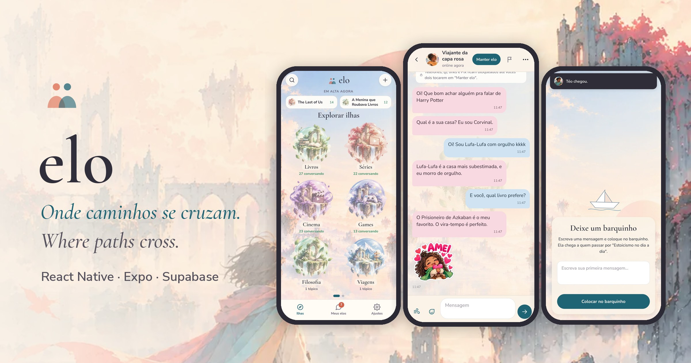
</p>

<p align="center">
  <b>English</b> · <a href="README.pt-BR.md">Português</a>
</p>

<p align="center">
  
  
  
  
  
  
</p>

# Elo

**Elo is a mobile app for talking to strangers about the things you love — and maybe making a friend along the way.**

You pick an *island* (Books, TV Shows, Games, Music…), choose a topic inside it and Elo connects you with another *traveler* who is there right now. If nobody is around, you leave your message in a **paper boat** that reaches whoever visits the topic next. If the conversation is good, you both **keep the link** and become contacts.

No photos, no real names, no email shown. Just the topic and the conversation.

> Elo is a **portfolio project**. It was designed and built end to end — product, UX, visual identity, mobile app, database and security rules — and tested on real Android phones with real accounts. It is not published on the stores.

## Try it

<table>
  <tr>
    <td align="center" width="230">
      <a href="https://github.com/Noirane/elo/releases/latest"></a><br>
      <sub>Scan with your Android phone</sub>
    </td>
    <td>
      <b><a href="https://github.com/Noirane/elo/releases/latest">⬇ Download the demo APK</a></b> (Android)
    </td>
  </tr>
</table>

The demo runs entirely on the phone, with no login and no server. The other travelers are simulated: each one has a personality and knows things about the topic, so conversations feel close to the real thing.

1. Scan the QR code with your Android phone camera (or open the link) and download the `.apk`.
2. Tap the file. If Android asks, allow installing apps from this source.
3. If Play Protect warns you, choose **Install anyway** (the app is not on the Play Store).

Things to try (in English): open **The Hunger Games** in the Movies island and chat; leave a paper boat in **Amateur astronomy** and wait a few seconds; open the first contact in *My links* to receive a gust of wind. In Portuguese, try **Harry Potter** and **Astronomia amadora**.

## Screenshots

| Islands | Topic | A new link | Conversation |
|:--:|:--:|:--:|:--:|
| 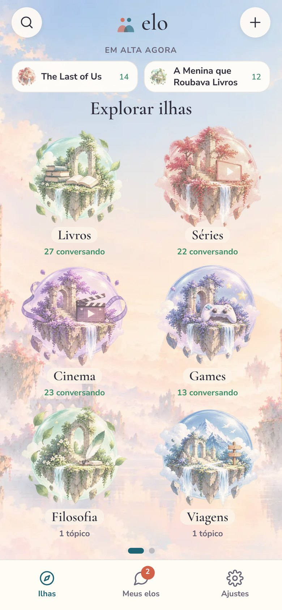 | 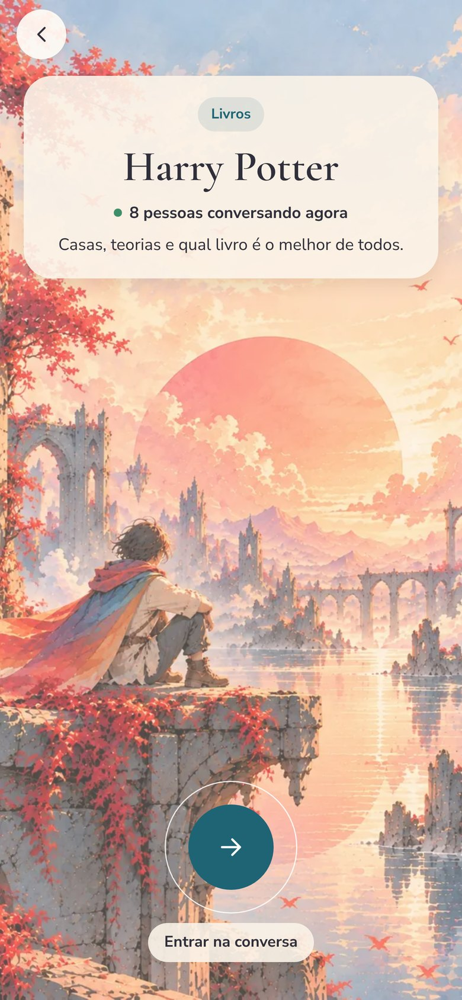 | 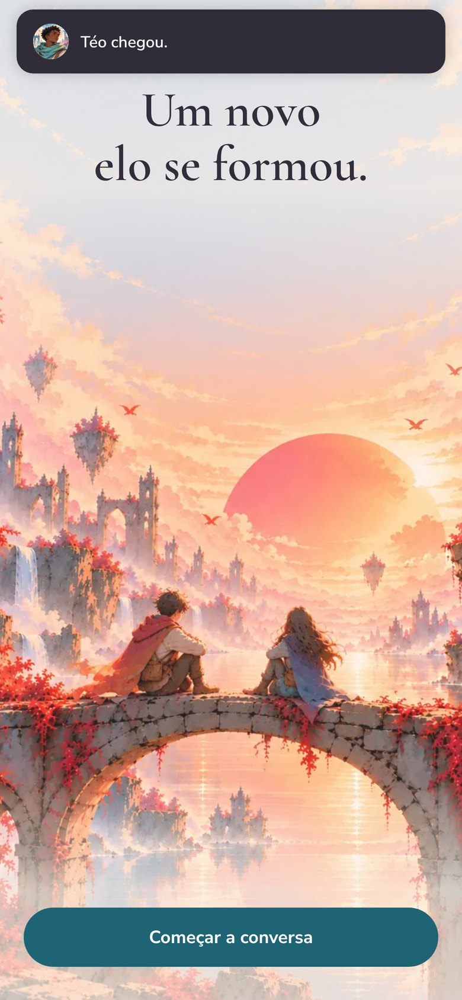 | 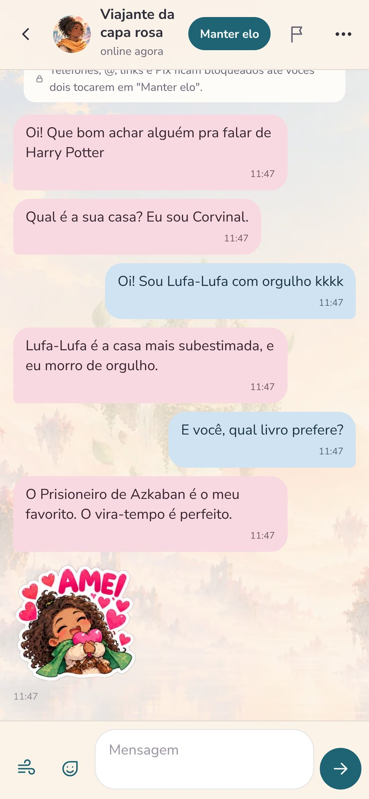 |

| Stickers | Paper boat | My links | Settings |
|:--:|:--:|:--:|:--:|
|  | 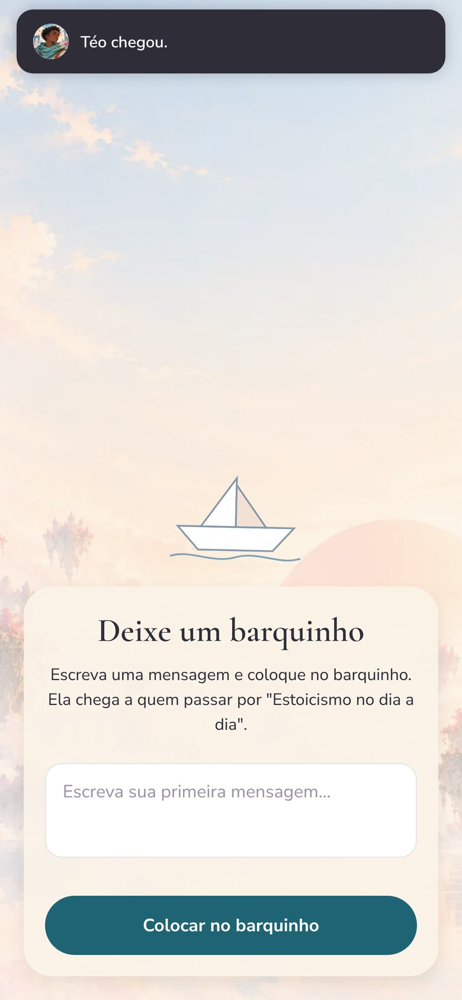 | 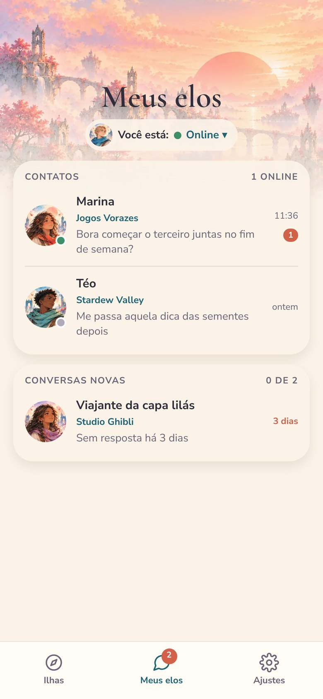 | 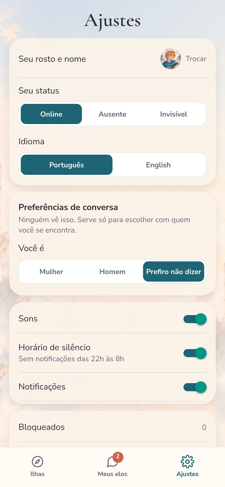 |

| Welcome | Onboarding | In English |
|:--:|:--:|:--:|
| 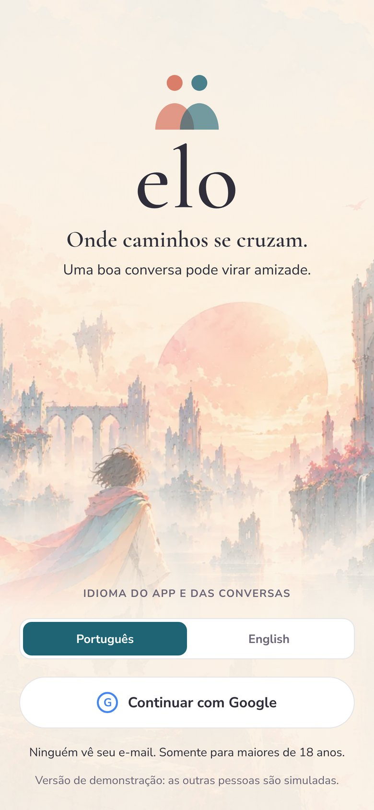 | 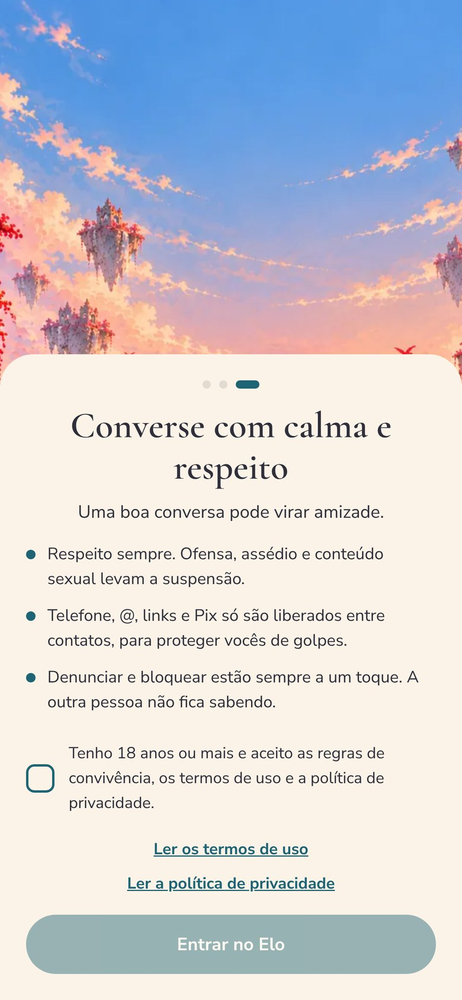 | 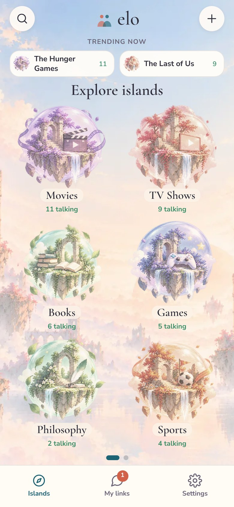 |

## Features

- **12 islands, topics by popularity.** Trending topics on the home screen, search with aliases ("hunger" finds *Jogos Vorazes*), and anyone can create a topic, with a warning when a similar one already exists.
- **Live matching.** Entering a topic looks for another traveler there for about 45 seconds.
- **Paper boat.** Nobody around? Your message goes to someone who visited the topic in the last 48 hours, or waits on the topic (up to 7 days) until someone arrives.
- **Keep the link.** When both people tap *Keep link*, the chat becomes a contact. Contacts show online / away / invisible status.
- **Conversation, MSN style.** Blue and pink bubbles, typing indicator, a leaf reaction (double tap), a hand-painted sticker pack, and the **gust of wind**: shakes the other person's screen, once every 10 minutes.
- **Your face and your name.** An illustrated face (8 options) and an optional traveler name. Real name and email are never shown.
- **Chat preferences.** Optional and invisible to others: women can choose to talk only with women.
- **Notifications** for new messages, paper boats, gusts of wind and kept links, respecting quiet hours (10 pm–8 am).
- **Portuguese and English**, chosen on the first screen.

## Safety by design

Elo was designed around one question: *how do we keep this a place for friendship and not for harassment?*

| Rule | How it works |
|---|---|
| 18+ only | Date of birth is checked in the app **and** in the database. |
| No contact details with strangers | Phone numbers, @handles, links, Pix and app names are blocked until both people keep the link — in the app and again on the server. |
| No offensive or sexual words | The message is not sent. The filter normalizes text first, so `p.u.t.a`, `puuuta` or `f0d4` are caught. Same list in the app and in Postgres. |
| No images or videos | Only text and the official sticker pack. |
| Report and block | One tap, the other person is never told. Blocked people never meet again; the same pair cannot meet again for 30 days. |
| Reports without reading chats | A report has a reason and an optional note. A case reaches the admin panel only when **3 different people** report the same person. Nobody on the team reads conversations. |
| Every rule lives on the server | Row Level Security on every table and `security definer` functions for every action: the phone is never the only barrier. |
| Account deletion | Deletes profile, chats, contacts and paper boats. |

## Architecture

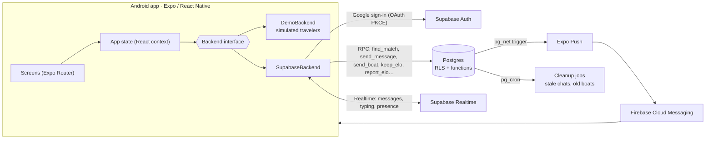

- **One interface, two backends.** All screens talk to a single `Backend` interface (`src/backend/types.ts`). Without server keys the app uses `DemoBackend`; with them, `SupabaseBackend`. That is what makes the offline demo possible without a single `if (demo)` in the screens.
- **Logic in the database.** Matching, paper boats, limits (2 open new chats, 30 messages/min, 5 topics/day), wind cooldown, keep-link handshake, reports and cleanup are Postgres functions. The client can only call them.
- **Realtime.** New messages and chat updates come from Postgres changes; "typing…" uses broadcast; online status uses presence.
- **Push.** A trigger on `messages` calls Expo Push through `pg_net`, which delivers through Firebase.

### The simulated travelers

The demo is not a list of canned replies. `src/backend/sim/` contains a small conversation engine:

- **Knowledge per topic** (`knowledge.ts`): characters and names the traveler can talk about, opinions and memories, and questions to ask back. Topics created by users fall back to knowledge about their island.
- **Intent detection** (`engine.ts`): greetings, "how are you", questions, "what's your favorite", laughter, agreement, disagreement, thanks, goodbyes and requests for personal data (politely deflected).
- **Memory:** never repeats an opinion or question, and never asks something you just answered.
- **Human timing:** typing time proportional to message length, messages split in two, stickers now and then.

## Tech stack

| | |
|---|---|
| App | Expo SDK 58, React Native 0.88, React 19, TypeScript, Expo Router |
| UI | expo-image, expo-linear-gradient, react-native-reanimated, react-native-svg, Cormorant Garamond + Nunito Sans |
| Device | expo-notifications, expo-haptics, expo-audio, expo-localization, AsyncStorage |
| Backend | Supabase: Auth (Google), Postgres with RLS and PL/pgSQL functions, Realtime, pg_cron, pg_net |
| Push | Expo Push + Firebase Cloud Messaging |
| Builds | EAS Build (`demo`, `preview` and `production` profiles) |

## Project structure

```
src/
  app/                 screens (each file is a route)
    entrada/           welcome, date of birth, onboarding
    (tabs)/            islands, my links, settings
    ilha/ topico/ encontro/ chat/   island → topic → matching → chat
    denuncias.tsx      admin report panel
    legal/             terms of use and privacy policy
  backend/
    types.ts           the Backend interface
    demo.ts            offline demo
    sim/               simulated travelers (knowledge + engine)
    supabase.ts        real backend
  components/          UI kit, icons, wind animation
  i18n/                Portuguese, English, legal texts
  lib/                 safety filters, notifications, sounds
  store.tsx            app state
supabase/
  schema.sql           the whole database: tables, RLS, functions, triggers, jobs
assets/elo/            illustrations, islands, faces, stickers, sounds
```

## Running locally

```bash
npm install
npx expo start          # opens the demo mode (no keys needed)
```

Build the demo APK yourself:

```bash
npx eas-cli@latest build --platform android --profile demo
```

### Connecting the real backend (optional)

1. Create a Supabase project and run `supabase/schema.sql` in the SQL editor (it is idempotent). Put your own email in `admin_emails` to see the report panel.
2. Create a Google OAuth client (web application) with the redirect URI `https://<your-project>.supabase.co/auth/v1/callback`, and enable Google in *Authentication → Providers*.
3. Add `elo://auth` to *Authentication → URL configuration → Redirect URLs*.
4. Copy `.env.example` to `.env` and fill in `EXPO_PUBLIC_SUPABASE_URL` and `EXPO_PUBLIC_SUPABASE_ANON_KEY` (the publishable key — never the secret key).
5. For push notifications on Android: create a Firebase project, add `google-services.json` to the project root, reference it in `app.json` (`android.googleServicesFile`) and upload the FCM V1 service account key to your Expo project.
6. `npx eas-cli@latest build --platform android --profile preview`

## Design

Watercolor illustrations, floating islands and soft paper tones. The vocabulary comes from travel (islands, travelers, bridges, paper boats) instead of social network jargon, and the interface is centered, readable and calm. Display type is Cormorant Garamond; body type is Nunito Sans.

## What I would do next

- AI moderation (meaning, not just words) for subtle harassment
- iOS version with Sign in with Apple
- Premium plan (more open chats)

## Author

Made by **Noirane Sá** — product, design and development.
Illustrations created with AI image tools under the author's art direction.

## License

[MIT](LICENSE)
