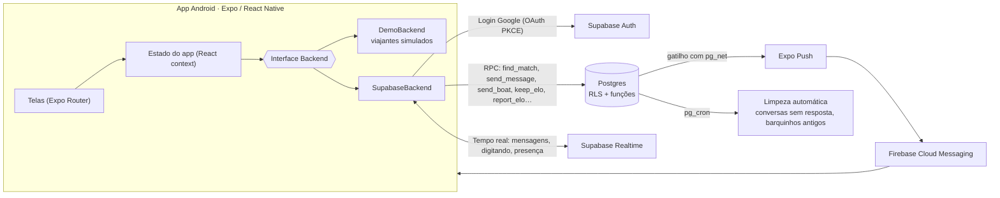

<p align="center">
  
</p>

<p align="center">
  <a href="README.md">English</a> · <b>Português</b>
</p>

<p align="center">
  
  
  
  
  
  
</p>

# Elo

**O Elo é um aplicativo para conversar com desconhecidos sobre o que você ama — e, quem sabe, fazer uma amizade no caminho.**

Você escolhe uma *ilha* (Livros, Séries, Games, Música…), entra num assunto dentro dela e o Elo liga você a outro *viajante* que está ali agora. Se ninguém estiver por perto, sua mensagem segue num **barquinho de papel** e chega a quem passar pelo assunto depois. Se a conversa for boa, vocês **mantêm o elo** e viram contatos.

Sem foto, sem nome verdadeiro, sem e-mail à mostra. Só o assunto e a conversa.

> O Elo é um **projeto de portfólio**. Foi pensado e construído de ponta a ponta — produto, experiência, identidade visual, app, banco de dados e regras de segurança — e testado em celulares Android de verdade, com contas reais. Ele não está publicado nas lojas.

## Experimente

<table>
  <tr>
    <td align="center" width="230">
      <a href="https://github.com/Noirane/elo/releases/latest"></a><br>
      <sub>Aponte a câmera do celular Android</sub>
    </td>
    <td>
      <b><a href="https://github.com/Noirane/elo/releases/latest">⬇ Baixar o APK de demonstração</a></b> (Android)
    </td>
  </tr>
</table>

A demonstração roda inteira no celular, sem login e sem servidor. Os outros viajantes são simulados: cada um tem personalidade e sabe coisas sobre o assunto, então a conversa fica bem perto da real.

1. Escaneie o QR code com a câmera do celular Android (ou abra o link) e baixe o arquivo `.apk`.
2. Toque no arquivo. Se o Android pedir, permita instalar apps desta fonte.
3. Se o Play Protect avisar, escolha **Instalar mesmo assim** (o app não está na Play Store).

Para testar: abra **Harry Potter** na ilha Livros e converse; deixe um barquinho em **Astronomia amadora** e espere alguns segundos; abra **Marina** em *Meus elos* para receber uma rajada de vento.

## Telas

| Ilhas | Tópico | Um novo elo | Conversa |
|:--:|:--:|:--:|:--:|
|  |  |  |  |

| Figurinhas | Barquinho | Meus elos | Ajustes |
|:--:|:--:|:--:|:--:|
|  |  |  |  |

| Entrada | Apresentação | Em inglês |
|:--:|:--:|:--:|
|  |  |  |

## O que o app faz

- **12 ilhas, tópicos por popularidade.** Assuntos em alta na tela inicial, busca com apelidos ("hunger" encontra *Jogos Vorazes*) e qualquer pessoa pode criar um tópico, com aviso quando já existe um parecido.
- **Encontro ao vivo.** Ao entrar num assunto, o app procura outro viajante ali por cerca de 45 segundos.
- **Barquinho.** Ninguém por perto? A mensagem vai para quem passou pelo assunto nas últimas 48 horas, ou fica esperando no tópico (até 7 dias) até alguém chegar.
- **Manter elo.** Quando as duas pessoas tocam em *Manter elo*, a conversa vira contato. Contatos mostram status online, ausente ou invisível.
- **Conversa no estilo MSN.** Balões azul e rosa, "digitando…", reação com folha (toque duplo), um pacote de figurinhas pintado em aquarela e a **rajada de vento**: balança a tela da outra pessoa, uma vez a cada 10 minutos.
- **Seu rosto e seu nome.** Um rosto ilustrado (8 opções) e um nome de viajante opcional. Nome verdadeiro e e-mail nunca aparecem.
- **Preferências de conversa.** Opcional e invisível para os outros: mulheres podem escolher conversar só com mulheres.
- **Notificações** de mensagem, barquinho, rajada de vento e elo mantido, respeitando o horário de silêncio (22h às 8h).
- **Português e inglês**, escolhidos na primeira tela.

## Segurança desde o desenho

O Elo foi pensado em volta de uma pergunta: *como manter isto um lugar de amizade, e não de assédio?*

| Regra | Como funciona |
|---|---|
| Só maiores de 18 | A data de nascimento é conferida no app **e** no banco de dados. |
| Sem contato com desconhecidos | Telefone, @, links, Pix e nomes de outros apps ficam bloqueados até os dois manterem o elo — no app e de novo no servidor. |
| Sem palavras ofensivas ou sexuais | A mensagem não é enviada. O filtro normaliza o texto antes, então `p.u.t.a`, `puuuta` ou `f0d4` também caem. A mesma lista vale no app e no Postgres. |
| Sem fotos e vídeos | Só texto e o pacote oficial de figurinhas. |
| Denunciar e bloquear | Um toque, sem a outra pessoa saber. Bloqueados nunca mais se encontram; o mesmo par não se reencontra por 30 dias. |
| Denúncia sem ler conversas | A denúncia tem um motivo e uma explicação opcional. O caso só chega ao painel de administração quando **3 pessoas diferentes** denunciam a mesma pessoa. Ninguém da equipe lê as conversas. |
| Toda regra mora no servidor | Row Level Security em todas as tabelas e funções `security definer` para cada ação: o celular nunca é a única barreira. |
| Excluir conta | Apaga perfil, conversas, contatos e barquinhos. |

## Arquitetura



- **Uma interface, dois backends.** Todas as telas falam com uma única interface `Backend` (`src/backend/types.ts`). Sem as chaves do servidor, o app usa o `DemoBackend`; com elas, o `SupabaseBackend`. É isso que permite a demonstração offline sem nenhum `if (demo)` nas telas.
- **Regras no banco.** Encontro, barquinho, limites (2 conversas novas abertas, 30 mensagens por minuto, 5 tópicos por dia), intervalo da rajada, o "manter elo" dos dois lados, denúncias e limpeza são funções no Postgres. O app só consegue chamá-las.
- **Tempo real.** Mensagens novas chegam pelas mudanças do Postgres; o "digitando…" usa broadcast; o status online usa presença.
- **Notificações.** Um gatilho na tabela de mensagens chama o Expo Push pelo `pg_net`, que entrega pelo Firebase.

### Os viajantes simulados

A demonstração não é uma lista de respostas prontas. Em `src/backend/sim/` há um pequeno motor de conversa:

- **Conhecimento por assunto** (`knowledge.ts`): personagens e nomes que o viajante comenta, opiniões e lembranças, e perguntas para devolver. Tópicos criados pelas pessoas usam o que se sabe sobre a ilha.
- **Entende o tipo de mensagem** (`engine.ts`): saudação, "tudo bem?", perguntas, "qual o seu favorito?", risadas, concordância, discordância, agradecimento, despedida e pedido de dados pessoais (desconversa com gentileza).
- **Memória:** não repete opinião nem pergunta, e não pergunta o que você acabou de responder.
- **Ritmo humano:** tempo de digitação proporcional ao tamanho da mensagem, respostas em duas partes e figurinhas de vez em quando.

## Tecnologias

| | |
|---|---|
| App | Expo SDK 58, React Native 0.88, React 19, TypeScript, Expo Router |
| Interface | expo-image, expo-linear-gradient, react-native-reanimated, react-native-svg, Cormorant Garamond + Nunito Sans |
| Aparelho | expo-notifications, expo-haptics, expo-audio, expo-localization, AsyncStorage |
| Servidor | Supabase: Auth (Google), Postgres com RLS e funções em PL/pgSQL, Realtime, pg_cron, pg_net |
| Notificações | Expo Push + Firebase Cloud Messaging |
| Builds | EAS Build (perfis `demo`, `preview` e `production`) |

## Estrutura do projeto

```
src/
  app/                 telas (cada arquivo é uma rota)
    entrada/           boas-vindas, data de nascimento, apresentação
    (tabs)/            ilhas, meus elos, ajustes
    ilha/ topico/ encontro/ chat/   ilha → tópico → encontro → conversa
    denuncias.tsx      painel de denúncias (administração)
    legal/             termos de uso e política de privacidade
  backend/
    types.ts           a interface Backend
    demo.ts            demonstração offline
    sim/               viajantes simulados (conhecimento + motor)
    supabase.ts        servidor real
  components/          componentes, ícones, animação do vento
  i18n/                português, inglês, textos legais
  lib/                 filtros de segurança, notificações, sons
  store.tsx            estado do app
supabase/
  schema.sql           o banco inteiro: tabelas, RLS, funções, gatilhos, rotinas
assets/elo/            ilustrações, ilhas, rostos, figurinhas, sons
```

## Rodando no computador

```bash
npm install
npx expo start          # abre a versão de demonstração (não precisa de chaves)
```

Para gerar o APK de demonstração:

```bash
npx eas-cli@latest build --platform android --profile demo
```

### Ligando o servidor real (opcional)

1. Crie um projeto no Supabase e rode `supabase/schema.sql` no SQL Editor (pode rodar mais de uma vez). Coloque o seu e-mail em `admin_emails` para ver o painel de denúncias.
2. Crie um cliente OAuth do Google (aplicativo da Web) com o endereço de retorno `https://<seu-projeto>.supabase.co/auth/v1/callback` e ative o Google em *Authentication → Providers*.
3. Adicione `elo://auth` em *Authentication → URL configuration → Redirect URLs*.
4. Copie `.env.example` para `.env` e preencha `EXPO_PUBLIC_SUPABASE_URL` e `EXPO_PUBLIC_SUPABASE_ANON_KEY` (a chave publishable — nunca a secreta).
5. Para notificações no Android: crie um projeto no Firebase, coloque o `google-services.json` na raiz do projeto, aponte para ele no `app.json` (`android.googleServicesFile`) e envie a chave de conta de serviço FCM V1 para o seu projeto na Expo.
6. `npx eas-cli@latest build --platform android --profile preview`

## Design

Ilustrações em aquarela, ilhas flutuantes e tons de papel. O vocabulário vem de viagem (ilhas, viajantes, pontes, barquinhos), e não do jargão de rede social, e a interface é centralizada, legível e calma. Títulos em Cormorant Garamond; textos em Nunito Sans.

## Próximos passos

- Moderação por IA (que entende o sentido, não só palavras) para assédio disfarçado
- Versão para iPhone com login Apple
- Plano Premium (mais conversas abertas)

## Autoria

Feito por **Noirane Sá** — produto, design e desenvolvimento.
Ilustrações criadas com ferramentas de imagem por IA, com direção de arte da autora.

## Licença

[MIT](LICENSE)
